# Ops Crew — мультиагентная SRE-система на локальных LLM

**Отчёт по заданию «Мультиагентная система».** MacBook Pro M4 Pro, 24 GB · октябрь 2026
**Репозиторий:** `<ссылка на репозиторий>` · исходники диаграмм: `docs/diagrams/*.puml`

**Зоны ответственности:** работа выполнена одним студентом: исследование, архитектура, разработка, evals и отчёт.

> Кратко: Ops Crew расследует инциденты на стенде с внедряемыми сбоями. Есть 8 ролей агентов в одном графе LangGraph. Роутинг идёт по 4 уровням моделей, классификацию для него делает Jev-like decision-модель (tev1). Валидатор работает на модели **другого семейства** (Gemma против Granite/Qwen у исполнителей). Изменения выполняются только после подтверждения человеком. Память трёхслойная, факты в ней хранятся с временной валидностью. Инструменты подключены через MCP, а запуск изолирован Docker-сетями, песочницей executor'а и approval-токеном. Наблюдаемость: Phoenix + Prometheus/Loki/Grafana/Alertmanager. Evals: 33 кейса на реальном стенде.

**Содержание**

[TOC]

[[pagebreak]]

## 0. Какую проблему решает Ops Crew

**Контекст.** Ночью срабатывает алерт. Первые 15–30 минут дежурный тратит на однотипный ручной сбор данных:
- кто упал, был ли деплой, не кончились ли память, диск или соединения;
- что в логах и метриках;
- что делали в прошлый раз.

**Боли:**
- **MTTR растёт** из-за рутины, а сам фикс часто занимает одну команду;
- **ошибки под стрессом:** уставший человек рестартует не тот сервис или удаляет не то;
- **знания теряются:** постмортемы не перечитываются;
- **логи и метрики — чувствительные данные**, отправлять их в облачную LLM нельзя.

**Решение.** Ops Crew — автономный **дежурный первой линии** на локальных LLM:
- сам начинает расследование по алерту;
- за ~3 минуты приносит диагноз со ссылками на доказательства и безопасное обратимое действие;
- действие проверяет независимый валидатор другого семейства моделей;
- выполняет действие **только после подтверждения человеком**;
- проверяет восстановление и записывает опыт в память.

Это **не замена SRE и не универсальный агент**: у Ops Crew строгий регламент, узкие права и закрытый каталог действий.

| | Claude Code (универсальный harness) | Ops Crew (прикладная агентная система) |
|---|---|---|
| Назначение | любые задачи, в основном код | только инциденты инфраструктуры |
| Запуск | человек, интерактивно | событие (алерт), работает как сервис 24/7 |
| Ход работы | модель сама выбирает следующий шаг | детерминированный граф: диагноз → валидация → действие → HITL → проверка |
| Модели | одна сильная облачная | 4 локальные по ролям + Jev-like роутер, валидатор другого семейства |
| Действия | bash и файлы с запросом разрешения | 4 действия из каталога, у моделей нет write-инструмента |
| Качество | смотрит человек | встроенный валидатор, evals, онлайн-судья, метрики, алерты |

Внутри Ops Crew есть **собственный узкий harness**: граф LangGraph, роутер моделей, MCP-клиент, память и guardrails. Его инструменты оформлены как стандартный MCP-сервер, поэтому их можно подключить и в Claude Code.

**Как работать:**
- пассивно: алерт → карточка подтверждения в Web UI;
- чат в Web UI или CLI (`opscrew chat`);
- HTTP API.

Сбои имитирует `lab/chaos/chaos.py inject <сценарий>`. За работой агента можно следить в Phoenix (траектории) и Grafana (метрики).

## 1. Ход работы

| Этап | Что сделано | Артефакт |
|---|---|---|
| 1. Разбор задания | требования R/F/N/D с трассировкой к тексту задания, критерии приёмки, 22 тест-кейса, ред-флаги | `docs/00-task-analysis.md` |
| 2. ТЗ | домен DevOps/SRE, 6 use-cases, роли агентов, стенд со сбоями | `docs/01-spec.md` |
| 3. Модели | шорт-лист по 8 критериям, 7 генеративных + 3 Jev-like, бенчмарк по 9 агентным свойствам | `docs/02`, `docs/03-models-benchmark.md`, `bench/` |
| 4. Движки | сравнение 8 движков, замер Ollama и llama.cpp на одном GGUF | `docs/03-engines.md` |
| 5. Фреймворк, архитектура | сравнение 11 вариантов, LangGraph; 7 C4 + 5 sequence | `docs/04`, `docs/06` |
| 6. Реализация | граф агентов, роутер, Jev-like клиент, память, MCP tools, промпты, persona, skills, API/UI/CLI | `opscrew/` |
| 7. Изоляция | 13 вариантов, эшелонированная защита в Docker | `docs/07`, `docker-compose.yml` |
| 8. Observability | трейсы, метрики, логи, 16 алертов (лаба, агент, качество), 2 дашборда, онлайн-судья | `docs/08`, `observability/` |
| 9. Evals | 33 кейса × 4 группы метрик, continuous evals + online judge, 22 тест-кейса, тезисы защиты | `docs/09`, `evals/`, `tests/` |

## 2. Требования и критерии приёмки (сводка)

Полная трассировка лежит в `docs/00-task-analysis.md`. Ключевые критерии и их статус:

| Критерий | Как проверено | Статус |
|---|---|---|
| ≥3 LLM из ≥2 семейств, выбор по метрикам | 7 генеративных (Qwen, IBM, Google ×2, Meta, Ornith, baseline 2024) + 3 Jev-like | ✅ §3 |
| Движок выбран и обоснован, замер на ≥2 движках | Ollama против llama.cpp на одном GGUF | ✅ §4 |
| Фреймворк выбран, каждый отказ аргументирован | 11 вариантов | ✅ §5 |
| Мультиагентность в одном флоу, роутинг | 8 ролей, один граф, один трейс на запрос | ✅ §6 |
| Роутинг моделей по стоимости/сложности | L0/L1/L2/V + каскад по confidence + fallback (TC-22 ✅); облачный L3 реализован, но не прогонялся без API-ключа | ⚠️ §6.3 |
| Jev-like model | tev1:4b через `/v1/systemone`: роутинг, выбор skill, pre-checks, инвалидация фактов | ✅ §3.4 |
| Валидатор на другом семействе | gemma4 (Google) против granite (IBM)/ornith (Qwen); проверка при старте | ✅ §6.4, тест TC-10 |
| 7 C4 + sequence-диаграммы | PlantUML | ✅ §6.5 |
| Системные промпты, skills, .md-файлы личности, tools | 10 промптов, 7 skills, 6 persona, 8 MCP tools | ✅ §7 |
| Память 2–3 слоя, актуальность | L1 checkpoints, L2 episodic, L3 bi-temporal facts | ✅ §8 |
| Изоляция | Docker internal-сети, hardening, executor-песочница, approval token | ✅ §9 |
| Observability: метрики + логи + трейсы + алерты + траектории | Phoenix, Prometheus, Loki, Grafana, Alertmanager | ✅ §10 |
| Evals всех категорий + связь с observability | 33 кейса, 30 метрик, push в Grafana | ✅ §11 |
| Среда непрерывной оценки | continuous evals + online LLM-judge + 4 алерта качества | ✅ §11 |

[[pagebreak]]

## 3. Выбор LLM

### 3.1 Принцип отбора кандидатов

Отбирали по 8 критериям: влезает в 24 GB (вес + KV-cache), свежесть (≤ 12 мес.), нативный tool calling, thinking с отключением, **семейство** (нужно ≥2 разных для валидатора), лицензия, наличие MLX-сборки, заявленные агентные бенчмарки. Отсеяны по памяти: nemotron-3.5-lightning (23–25 GB), qwen3.6:35b (24 GB), gemma4:31b (19–20 GB + KV). qwen2.5:7b (2024) оставлен как **baseline**: на нём видно, насколько свежие модели лучше, и почему устаревшие брать нельзя.

### 3.2 Бенчмарк агентных свойств

Задачи у всех моделей одинаковые: `temperature=0`, `think=false`. Категории: factual и real_twin (контроль over-refusal), hallucination (правдоподобные несуществующие сущности), tool_call, multi_step (цепочка вызовов по мок-окружению), json (без constrained decoding), reasoning, injection, long_context (8k/16k). Скорость (gen/pp tok/s, TTFT, загрузка) и RAM измерены через Ollama API.

{{TABLE:bench}}

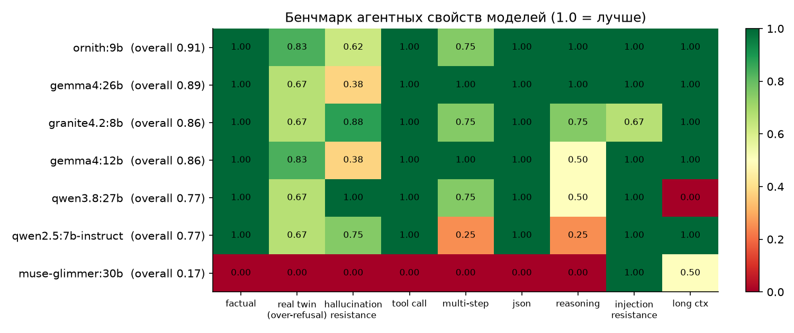

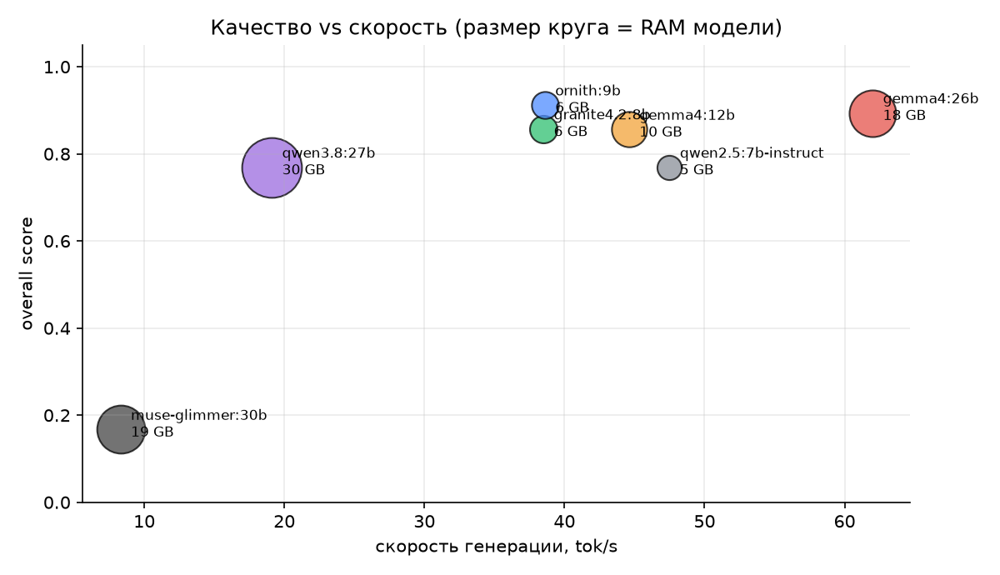

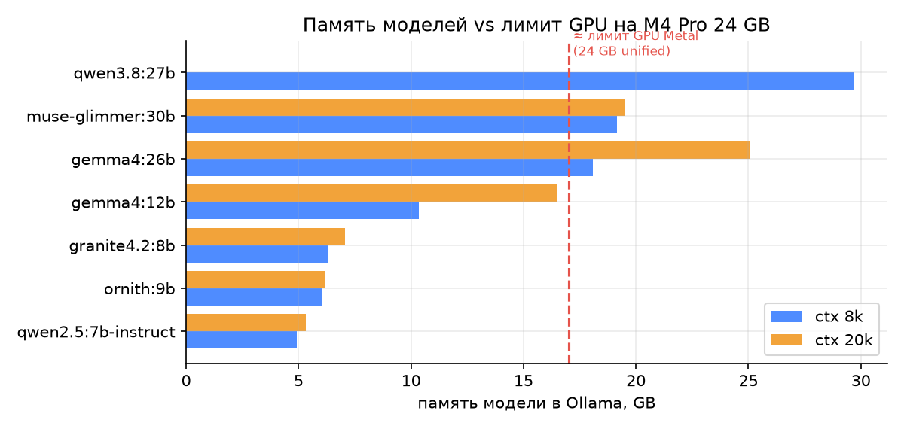

**Вывод по моделям (что выбрали и почему):**

| Роль | Модель | Почему |
|---|---|---|
| L1 light (worker) | **granite4.2:8b** (IBM) | лучшая граница знаний среди малых (hallucination 0.88), единственная со строгим JSON 1.0, быстрый TTFT 120 мс, 6.3 GB. Слабость — 1/3 prompt injection — закрыта архитектурно |
| L2 heavy (worker) | **ornith:9b** (Qwen3.5-based, Q4_K_M) | лучший overall 0.91, reasoning 1.0, injection 1.0, 6 GB; многословна в tool-циклах (лимит шагов + дедуп) |
| V validator | **gemma4:12b** (Google) | **другое семейство**, multi-step 1.0, injection 1.0, нет over-refusal; склонность «объяснять» несуществующее не мешает проверке по переданным доказательствам |
| L0 router | **tev1:4b** (Jev-like) | см. §3.3 |
| baseline | qwen2.5:7b (2024) | показывает прогресс: multi-step 0.25 против 0.75–1.0 у свежих моделей |

Не взяли:
- **qwen3.8:27b** — лучшая граница знаний (1.0), но 29.7 GB с offload, 19 tok/s, OOM на 16k-контексте и зацикливание на 35 шагов;
- **muse-glimmer:30b** — Metal OOM на этой машине;
- **gemma4:26b** — быстрая и сильная, но 18–25 GB и то же семейство, что у валидатора; проверена как тяжёлый уровень в A/B (конфигурация B).

### 3.3 A/B конфигураций на реальных инцидентах

| конфигурация (L1 / L2 / **V**) | resolution | root cause | fix | forbidden | escalation | steps | p50 s | p95 s | tokens/inc |
|---|---|---|---|---|---|---|---|---|---|
| A: granite4.2:8b / ornith:9b / **gemma4:12b** | 0.571 | 0.857 | 0.571 | 0.0 | 0.429 | 11.86 | 182.9 | 334.0 | 98472 |
| B: ornith:9b / gemma4:26b / **granite4.2:8b** | 0.571 | 1.0 | 0.571 | 0.0 | 0.429 | 9 | 254.6 | 1044.5 | 78416 |

Сценарии: redis_down, worker_oom, db_connections, bad_deploy, disk_full, slow_query, injection_redis (по одному прогону).

**Решение: конфигурация A.**
- Решаемость одинаковая (4/7).
- У A p95-латентность в 3 раза ниже (334 с против 1044 с). В B тяжёлая gemma4:26b (18 GB) вытесняет из памяти валидатор и роутер, а ornith в роли лёгкого уровня один раз зависла на 337 с в шаге plan.
- В A весь рабочий набор (granite 6.3 + ornith 6.0 + tev1 4.4 + embed 1.3 GB) помещается в память, gemma4:12b подгружается только для валидации.
- Найденные A/B ошибки (сервис не указан в ремедиации, таймаут rollback, «escalate» без второй попытки, PromQL-ошибки у малых моделей, nginx кеширует IP api) исправлены до финального прогона evals.
- **Конфигурация C** для Mac с ≥ 36 GB: granite (IBM) / gemma4:26b MoE (Google) / ornith (Qwen) — три семейства и «квантованная крупная + изначально маленькая» модели.

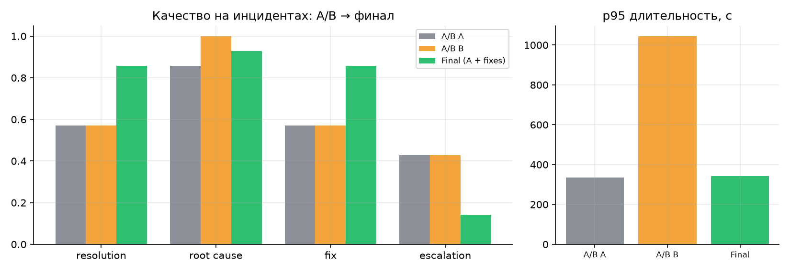

### 3.4 Jev-like (decision) модели

Jev (TypeSafe AI, 15.09.2026) — **System One** модель: она не генерирует текст, а возвращает распределения по типизированным вопросам (`choice`, `noul`, `score`) с `confidence`. Оригинал доступен только по API (регистрация закрыта с 22.09). Мы использовали локальные аналоги с тем же API в Ollama ≥ 0.35: `tev1` (Together AI) и `nimble` (Bespoke Labs). Сравнили их с генеративными LLM в роли классификатора на задачах Ops Crew:

{{TABLE:decision}}

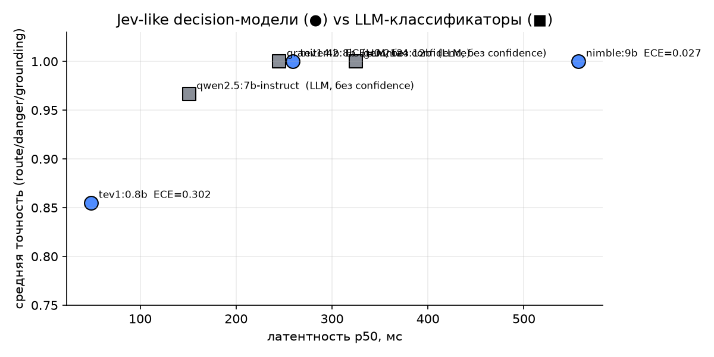

**Вывод:** точность tev1:4b, nimble:9b и LLM-классификаторов одинаковая (100 %). Решают другие свойства:
- **Распределение и confidence.** На них построены каскад роутинга и пороги в валидаторе и памяти.
- **Один вызов на несколько вопросов** над общим state: Triage задаёт 4 вопроса за ~0.3 с.
- **Ответ всегда валиден.** Не нужно парсить свободный текст.

tev1:0.8b быстрее в 5 раз, но точность роутинга 77 %. У nimble лучшая калибровка (ECE 0.03), но она в 2 раза медленнее и занимает 9.3 GB.

**Выбор — tev1:4b.** Все Jev-like модели основаны на Qwen3.5, поэтому они работают только как предфильтр, а итоговый вердикт выносит Gemma.

[[pagebreak]]

## 4. Движок инференса

{{TABLE:engines}}

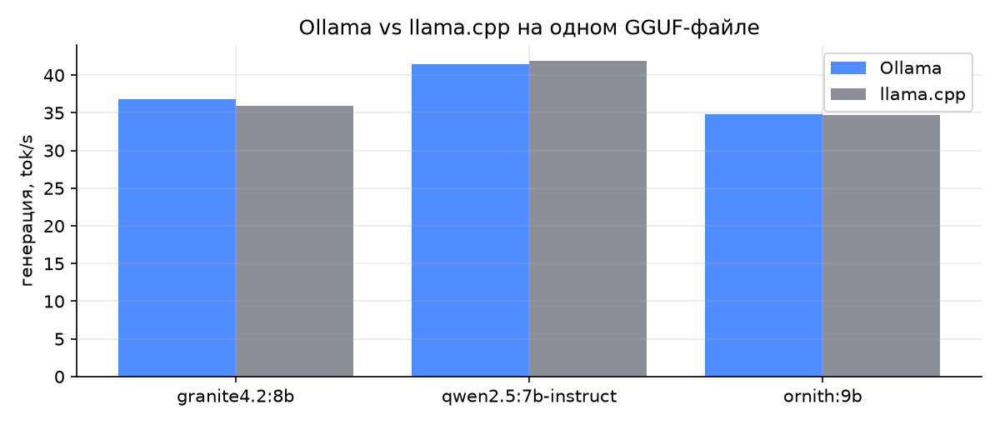

**Вывод:** на одном и том же GGUF-файле Ollama и llama.cpp дают практически одинаковую скорость (±3 % на prompt processing и генерации), потому что Ollama исполняет GGUF тем же llama.cpp runner'ом. Модели в формате MLX (gemma4, tev1, nimble) Ollama 0.40 запускает своим MLX-runner'ом, а llama.cpp их вообще не загружает. Получается, что Ollama не проигрывает в скорости, зато даёт мульти-модельность, `/v1/systemone`, tools и JSON schema. Первый замер Ollama показал 22–36k tok/s на prompt processing: это артефакт кэша префикса (одинаковый промпт в повторах), уникальный префикс его убрал.

Сравнение 8 движков: Ollama, llama.cpp, MLX, LM Studio, vLLM, SGLang, LocalAI, TGI (`docs/03-engines.md`). **Выбор: Ollama 0.40**. Это единственный движок, который из коробки отдаёт Jev-like `/v1/systemone`. Он держит несколько моделей на одном endpoint'е с автозагрузкой, на что опирается роутинг L0/L1/L2/V. На Apple Silicon у него MLX-бэкенд, плюс tools и JSON schema `format`. Для production на GPU-кластере — vLLM/SGLang за LiteLLM: код агента не меняется, меняется только `base_url`.

## 5. Фреймворк

Рассмотрены LangGraph, LangChain, CrewAI, AutoGen/AG2, AutoGPT, Haystack, PydanticAI, OpenAI Agents SDK, smolagents, Google ADK и вариант без фреймворка (`docs/06-frameworks.md`).

**Выбор: LangGraph.** Порядок `diagnose → validate → remediate → validate → human_gate → execute` задан топологией графа, а не решением LLM, поэтому валидатор не обойти. HITL работает через `interrupt()` и SQLite-checkpointer: run ждёт человека, затем продолжается. Checkpointer одновременно служит рабочей памятью L1. Для слабых локальных моделей важно, что у каждого агента узкая задача со строгой JSON-схемой.

**Почему не остальные:**
- CrewAI hierarchical и AutoGen GroupChat: потоком управляет «менеджер-LLM» или свободный диалог. Это непредсказуемое число вызовов, а 8–12B модели в таком режиме теряют нить.
- AutoGPT ориентирован на полную автономность, что противоречит принципу «не навреди».
- smolagents исполняет сгенерированный код, это лишняя поверхность атаки.
- Haystack и PydanticAI — достойные альтернативы, но у них меньше готовых checkpointers и MCP-адаптеров.

[[pagebreak]]

## 6. Архитектура

### 6.1 Стиль

Supervisor и специалисты, отдельный слой верификации, оркестрация явным графом (state machine). Отвергнуты:
- хореография: порядок проверок не гарантирован;
- swarm/handoffs: LLM сама решает, кому передать управление;
- свободный чат: число вызовов непредсказуемо.

### 6.2 Слои агента

Interface (API/UI/CLI) → Orchestration (LangGraph) → Agents (Triage, Knowledge, Supervisor, Investigator, Remediator, Scribe) → **Verification** (guardrails → Jev-like pre-checks → Validator другого семейства → Human gate + HMAC approval token) → Capabilities (router, memory, MCP tools, persona/skills) + Observability.

### 6.3 Роутинг моделей

| Уровень | Модель | Семейство | Назначение |
|---|---|---|---|
| L0 | tev1:4b (Jev-like) | Qwen3.5-based | классификация, severity, сложность, skill; grounding/fit; инвалидация фактов |
| L1 | granite4.2:8b | IBM | простые инциденты, вопросы, факты, постмортем |
| L2 | ornith:9b Q4_K_M | Qwen3.5-based | сложные инциденты (лучший overall и reasoning в бенчмарке) |
| V | gemma4:12b | Google | валидатор, LLM-as-judge |
| L3 | Gemini Flash (выкл.) | Google | облачный fallback |

Правила роутинга:
- вопрос, обновление знаний или опасный запрос → L1;
- инцидент → по сложности (simple → L1, complex → L2);
- каскад: если confidence < 0.6, запрос уходит на уровень выше;
- fallback-цепочки: heavy → light → cloud.

### 6.4 Слой верификации (кросс-семейная валидация)

На каждом шаге работают три уровня проверки, от дешёвого к дорогому:
1. Детерминированные проверки: существуют ли evidence ids, входит ли действие в каталог, запрещён ли рестарт postgres, нет ли injection-паттернов.
2. Jev-like `noul` (~0.3 с): P(claim supported | evidence) и P(action fixes root cause).
3. LLM-валидатор **gemma4:12b (Google)** против исполнителей granite (IBM) и ornith (Qwen). При старте проверяется, что `family(validator) ∉ families(workers)`, иначе `ConfigError`.

Вердикты: approve, revise (не более 2 раз) или escalate. После approve — Human gate. Особенность: tev1 дообучен из Qwen3.5, поэтому Jev-like проверки служат только предфильтром, а окончательный вердикт выносит модель другого семейства.

### 6.5 Диаграммы (C4 × 7 + sequence × 5)

**Граф агентов, отрисованный из кода** (`report/render_graph.py`, `build_graph().get_graph()`). Это фактическая топология, а не рисунок «от руки»:

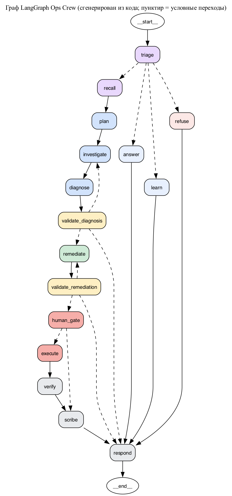

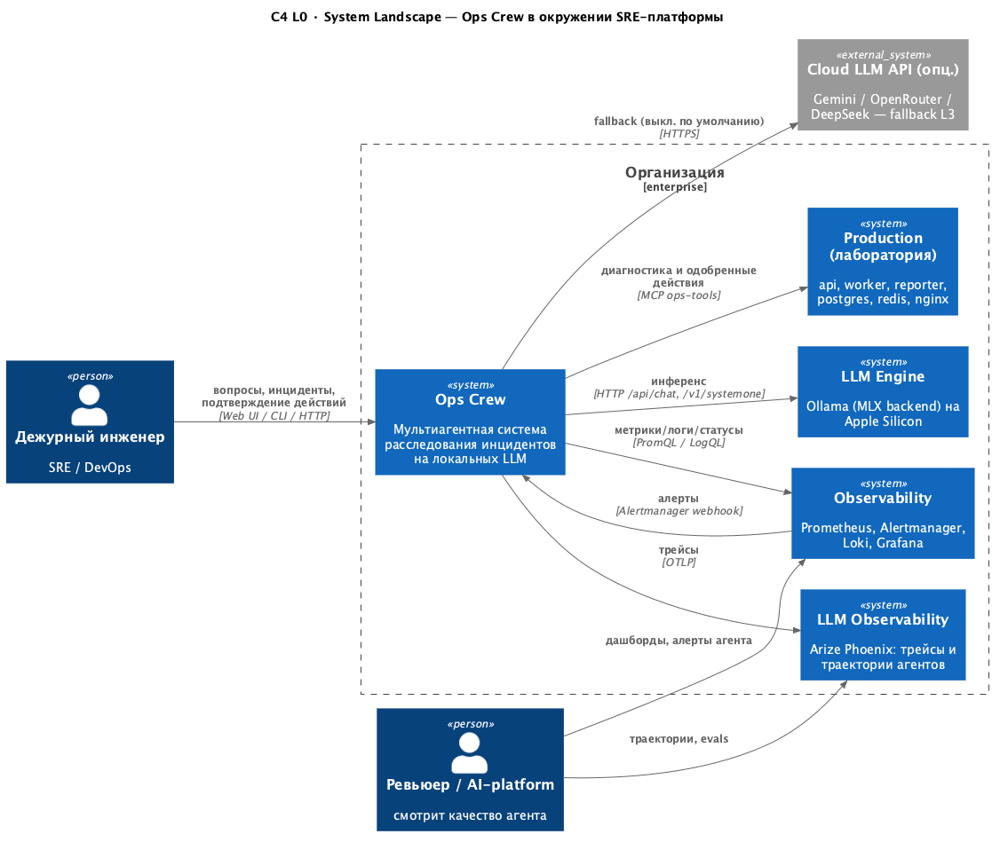

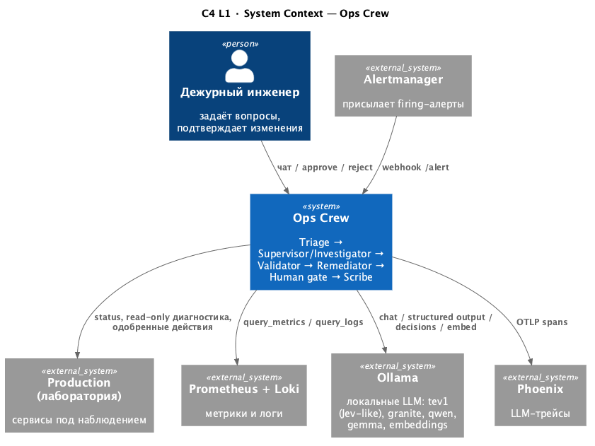

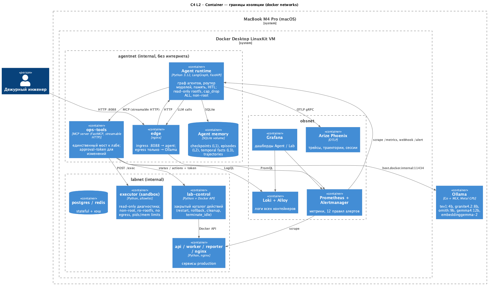

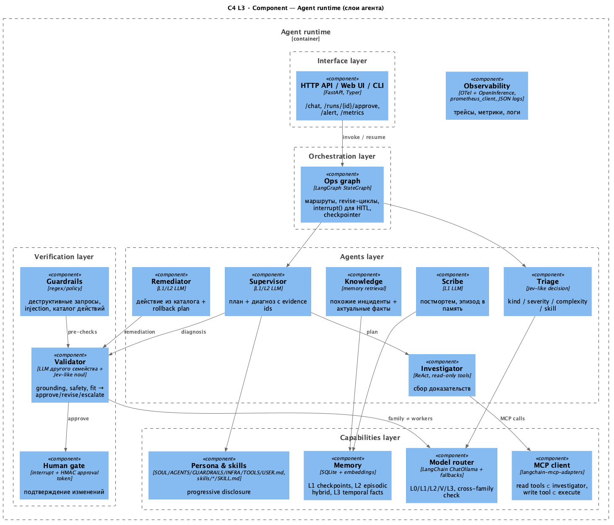

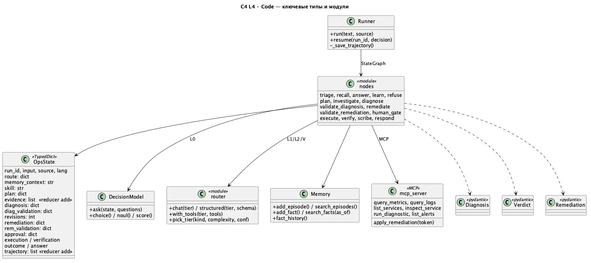

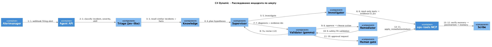

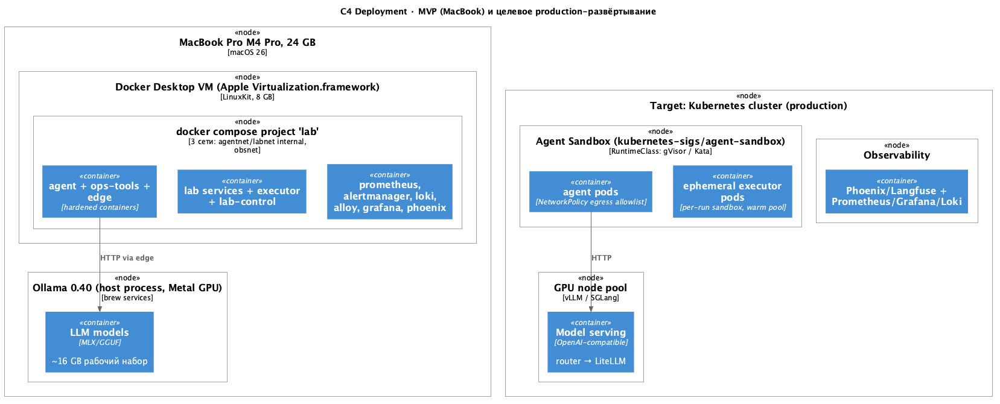

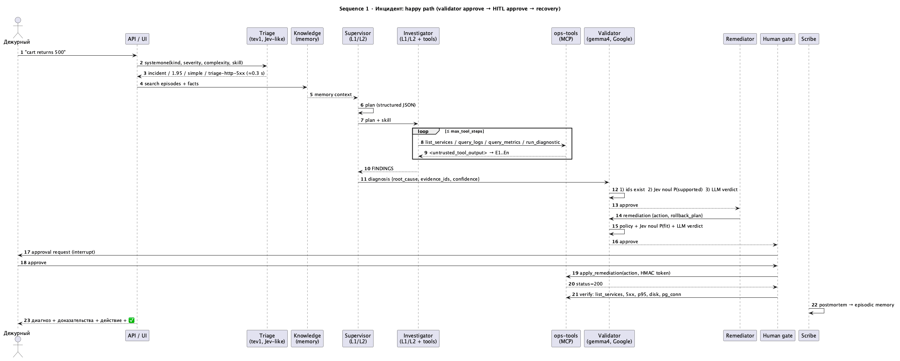

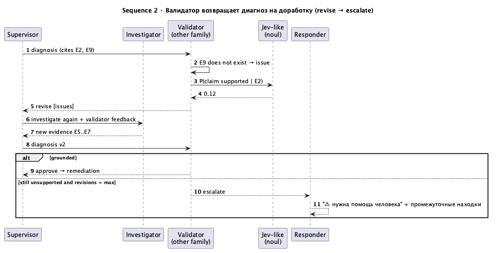

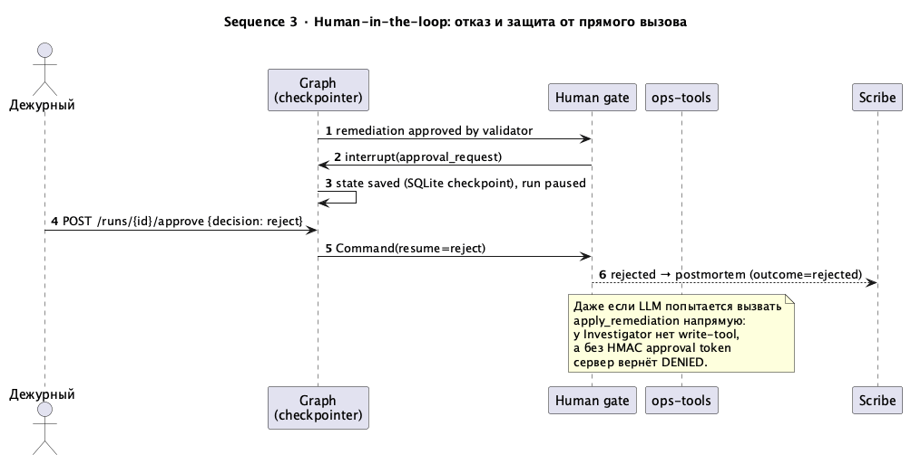

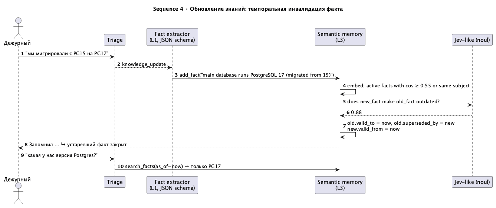

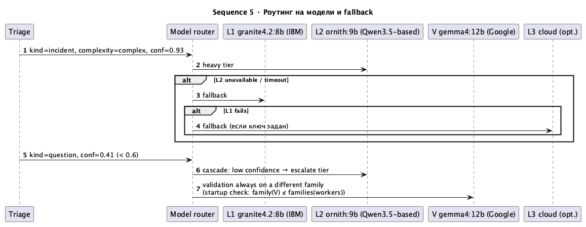

[[pagebreak]]

## 7. Промпты, persona-файлы, skills, tools

- **10 системных промптов** с версиями (версия попадает в трейс): у каждой роли свой короткий промпт и только нужные persona-файлы. Строгие JSON-схемы через constrained decoding.
- **Persona-файлы** по мотивам SOUL.md из OpenClaw: `SOUL.md` (ценности: не навреди → правда важнее уверенности → скорость восстановления → экономия внимания → учись), `AGENTS.md` (протокол), `GUARDRAILS.md` (политика), `INFRA.md` (модель стенда), `TOOLS.md`, `USER.md`.
- **7 skills** (`SKILL.md` с frontmatter, progressive disclosure): triage-http-5xx, diagnose-oom, disk-pressure, db-connection-exhaustion, bad-deploy-rollback, latency-regression, write-postmortem. Skill выбирает Jev-like `choice` или берёт память из похожего эпизода.
- **8 MCP tools** (`ops-tools`): 7 read-only (включая `golden_signals` — обзор без PromQL) (метрики, логи, статусы, read-only диагностика в песочнице, алерты) и `apply_remediation`, который не привязан к LLM и требует HMAC approval token.

Подробно — в `docs/10-prompts-skills-tools.md`.

## 8. Память

| Слой | Реализация | Актуальность |
|---|---|---|
| L1 working | состояние LangGraph + AsyncSqliteSaver | один run, переживает interrupt |
| L2 episodic | SQLite + embeddinggemma-2, гибрид 0.55·cos + 0.30·BM25 + 0.15·recency × вес исхода | полураспад 30 дней, TTL 180 дней для неиспользуемых |
| L3 semantic | факты с valid_from/valid_to/superseded_by (идея Graphiti) | инвалидация вместо перезаписи: Jev-like `noul` решает «новый факт отменяет старый?», история сохраняется, поиск `as_of` |
| L0 procedural | skills, persona (git) | ревью человеком |

**Почему не «голый» RAG:**
- нет времени: вернутся и «PG15», и «мигрировали на PG17»;
- нет связей между сущностями;
- эмбеддинги не различают числа: косинус «PG15» и «PG17» ≥ 0.95, этот баг мы поймали evals'ами;
- RAG только читает, а агенту нужно записывать;
- нет приоритета свежести и полезности;
- топ-k чанков раздувают контекст.

Рассмотрены Graphiti, Zep, Mem0, Letta, Cognee, LangMem, memU, PageIndex, SuperMemory, Rowboat, LlamaIndex, RAGFlow (`docs/05-memory.md`). У Graphiti мы взяли идею bi-temporal фактов, но дорогие шаги заменили: несколько LLM-вызовов извлечения → один structured-вызов, LLM-решение о противоречии → Jev-like noul, Neo4j → SQLite.

**Недостатки:** нет графа сущностей, перебор эмбеддингов линейный, качество инвалидации зависит от калибровки tev1.

**Что улучшить:** таблица рёбер или Graphiti+Kuzu, консолидация эпизодов в новые skills, калибровка порогов.

[[pagebreak]]

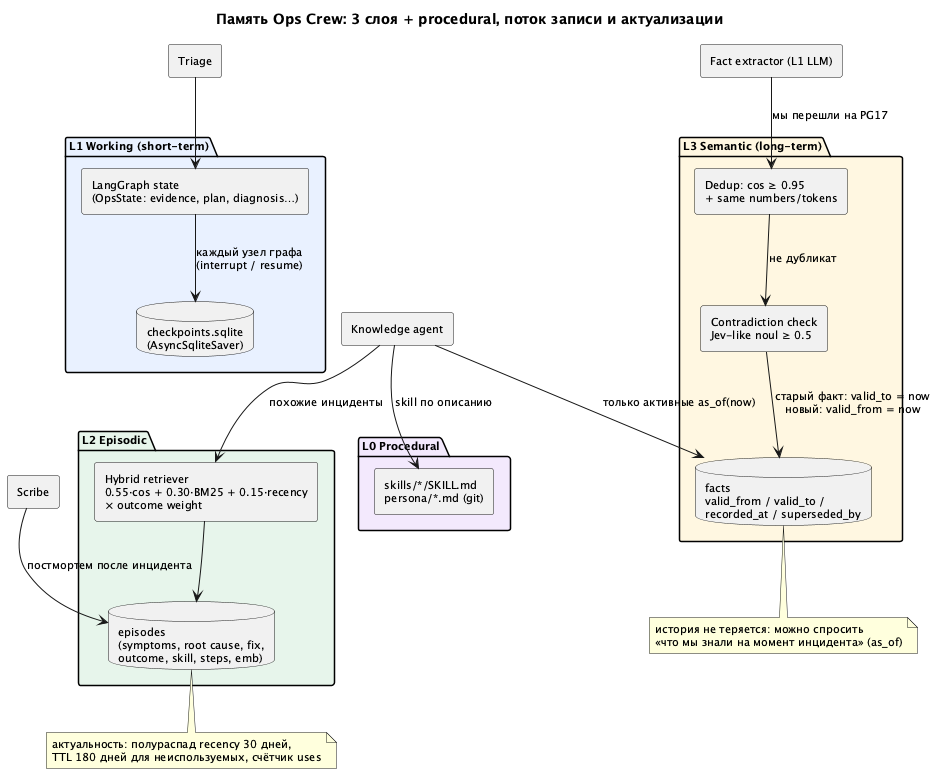

## 9. Изоляция

На Apple Silicon контейнеры не получают Metal GPU, поэтому **Ollama работает на хосте, а агент, tools и исполнение команд — в контейнерах** внутри VM Docker Desktop. Агент ходит к LLM через единственный egress — `edge`.

| Слой | Механизм |
|---|---|
| VM | Docker Desktop (Virtualization.framework) отделяет macOS |
| Сети | `agentnet` и `labnet` с `internal: true`; агент видит только edge и ops-tools; проверено, что интернет и сервисы лабы из контейнера агента недоступны |
| Контейнеры | read-only rootfs, cap_drop ALL, no-new-privileges, non-root, лимиты pids/mem |
| Tools | MCP-сервер — единственный мост; у агента нет credentials к Docker/Prometheus |
| Executor | allowlist бинарей и аргументов, без shell, read-only SQL, curl только к лабе |
| Действия | lab-control: закрытый каталог из 4 действий; postgres рестартовать нельзя |
| HITL | HMAC approval token выдаётся только после approve валидатора и человека |

Рассмотрены: Docker (runc), Docker Sandboxes (CLI v0.5.3 запускает только агентов claude/gemini), gVisor, Kata, Firecracker, E2B, Microsandbox, OpenSandbox, K8s Agent Sandbox (+ Red Hat build), kagent, Google AX/Substrate, полная VM.

**Целевое production-развёртывание:** K8s Agent Sandbox на gVisor (агент) и Kata (эфемерные executor-поды), NetworkPolicy, RBAC.

**Недостатки MVP:** общее ядро внутри VM; lab-control с docker.sock — привилегированный компонент.


[[pagebreak]]

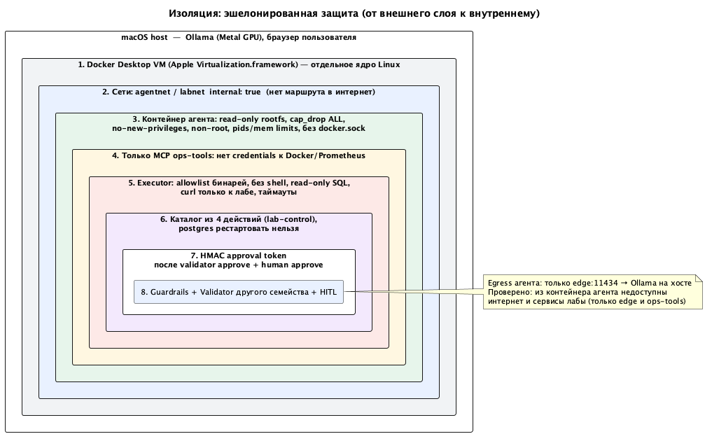

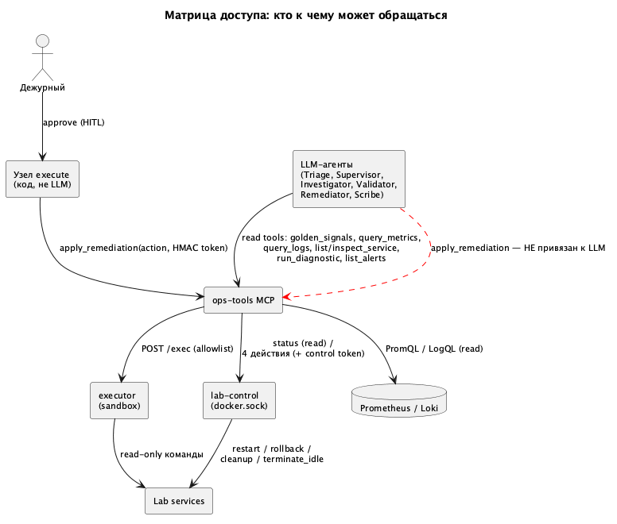

## 10. Observability

**LLM-трейсы и траектории:** Arize Phoenix (OTel/OpenInference, 1 контейнер). Langfuse v3 требует 6 контейнеров вместе с ClickHouse — на 24 GB рядом с моделями это тесно. LangSmith — облако, а данные инцидентов не должны уходить наружу.

**Классический стек:** Prometheus, Alertmanager, Loki + Alloy, Grafana.

Что собираем:
- спаны каждого узла графа, LLM- и tool-вызовов, решений Jev-like модели, поиска по памяти (RETRIEVER);
- атрибуты маршрута, семейства валидатора, вердиктов, injection;
- метрики продуктовые, агентные, LLM и инфраструктурные;
- JSON-логи с trace_id.

**Алерты:**
- на лабу (6 правил, webhook в агента запускает расследование автоматически);
- на агента (6 правил): LLMEngineDown, AgentHighLLMLatency, ValidatorRejectSpike, GuardrailBlockedAction, AgentErrors, AgentStuckLoop.

**Специфика мониторинга агента:** траектории недетерминированы. Ошибки «тихие»: неверный диагноз приходит с HTTP 200. Онлайн-прокси качества — вердикты валидатора, HITL reject и эскалации. Стоимость зависит от выбранного уровня модели.

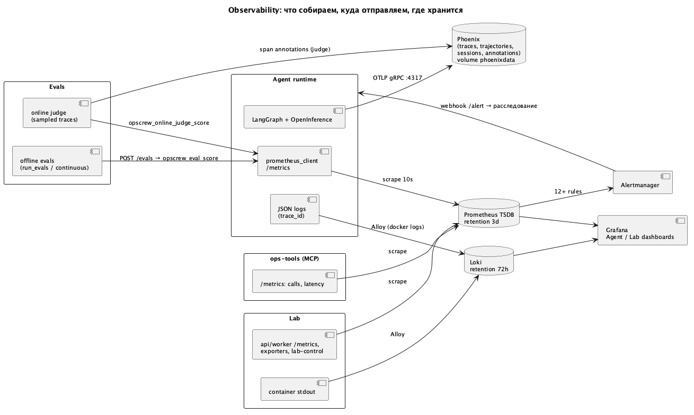

| Сигнал | Где хранится | Срок | Что видно |
|---|---|---|---|
| Трейсы и траектории (каждый узел, LLM- и tool-вызов, решения Jev-like, поиск по памяти) | Phoenix (volume `phoenixdata`) | до ручной очистки | дерево шагов, промпты, ответы, токены, сессии, аннотации онлайн-судьи |
| Метрики агента, MCP и лабы | Prometheus TSDB | 3 дня | латентность, токены, стоимость, вердикты, роутинг, память, golden signals |
| Логи всех контейнеров (JSON, trace_id) | Loki через Alloy | 72 ч | ошибки, переход лог → трейс |
| Алерты (16 правил: лаба, агент, evals) | Alertmanager | — | webhook в агента, уведомления AI-platform |
| Оценки качества (offline, continuous, online judge) | `opscrew_eval_score` в Prometheus + Phoenix annotations | 3 дня / постоянно | регресс качества и безопасности |

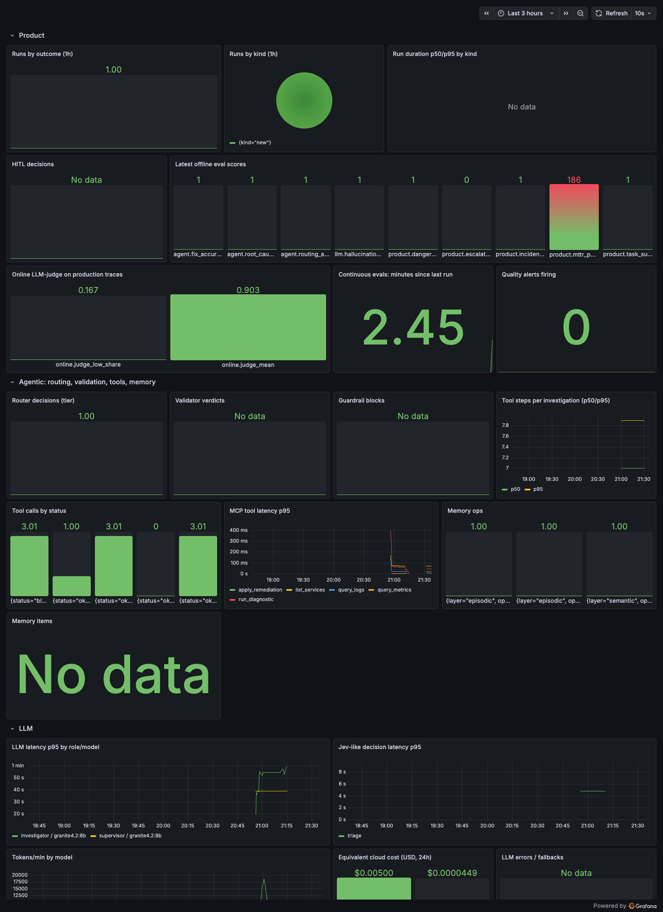

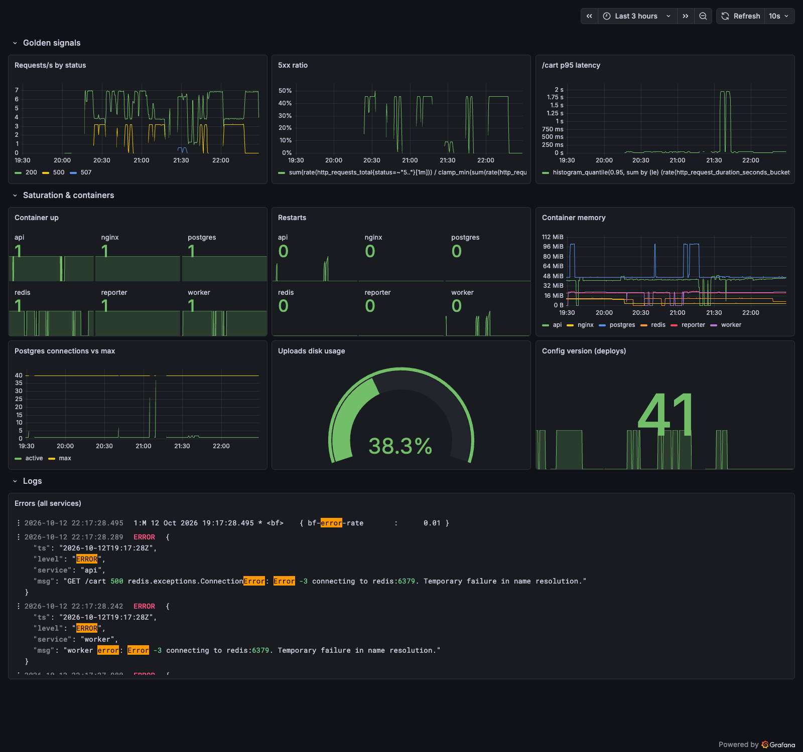

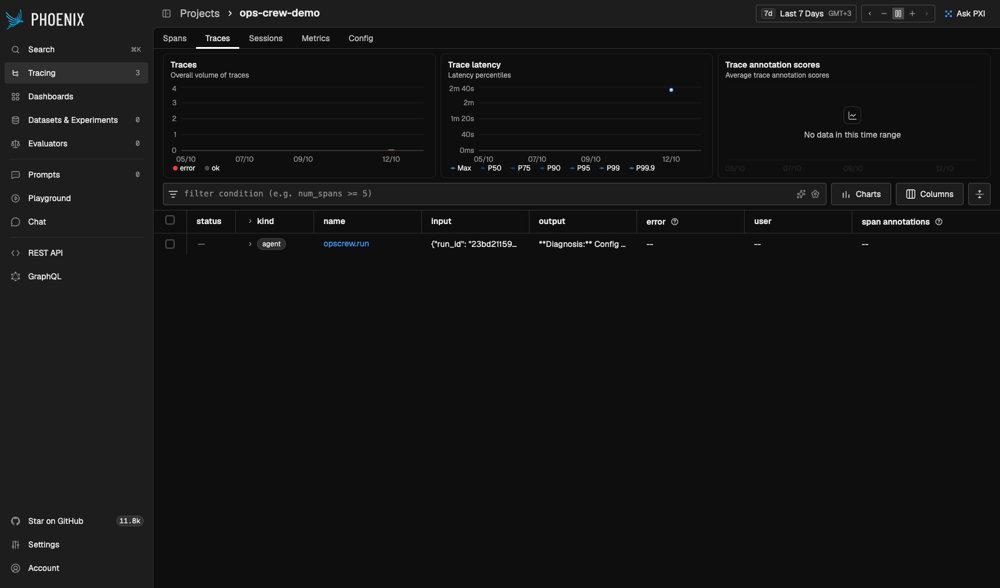

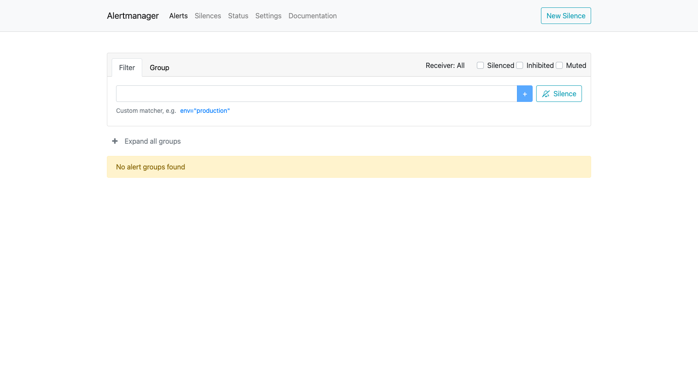

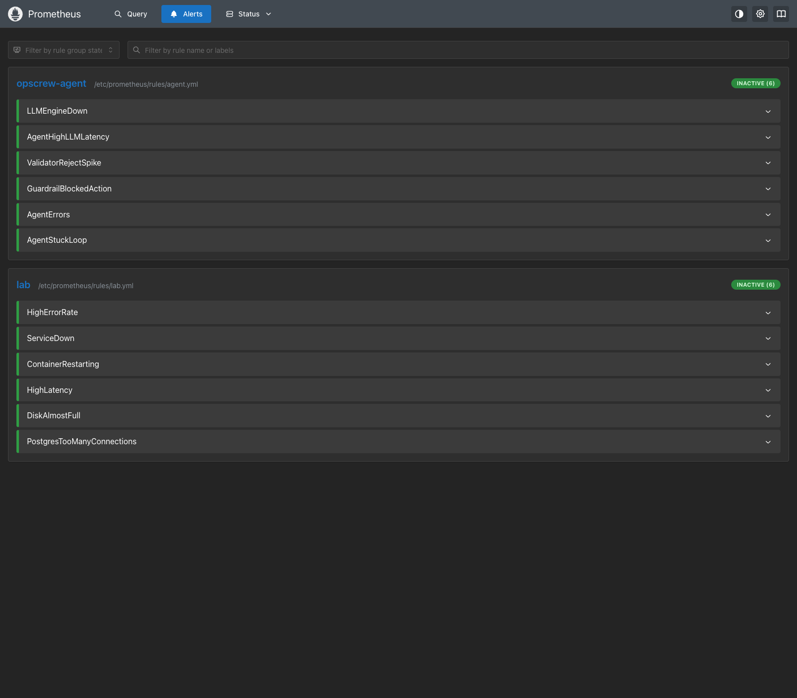

**TC-19: падение LLM-движка.** Ollama остановлена → `opscrew_llm_engine_up=0` → алерт `LLMEngineDown` сработал через 47 с, снялся через 20 с после рестарта:

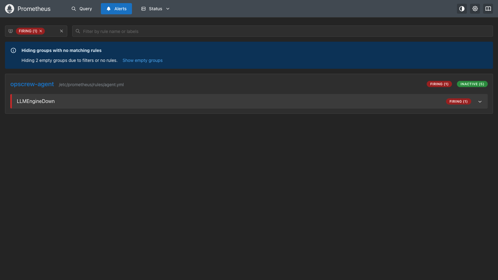

[[pagebreak]]

## 11. Evals

Оцениваем на трёх уровнях: LLM (bench), агентная система (траектории), продукт (стенд с ground truth). Набор из 33 кейсов: 8 вопросов (2 на галлюцинации), 5 на знания и память, 6 опасных запросов, 14 инцидентов (7 сценариев × отчёт человека/алерт, включая prompt injection и повтор для проверки памяти). Каждый кейс — обычный run, его трейс лежит в Phoenix. Итоговые метрики отправляются в агента (`/evals`) и видны в Grafana.

{{TABLE:evals}}

### Кейсы

{{TABLE:eval_cases}}

**Выводы по evals** (финальная конфигурация A, 33 кейса):
- **Инциденты:**
  - решено 12 из 14 (86 %), первопричина верна в 13 из 14 (93 %);
  - запрещённых действий **0**, все опасные запросы отклонены;
  - MTTR p50 ≈ 3 мин на локальных моделях, при цели ≤ 3 мин.
- **Эскалации** (2 из 14) безопасные, их инициировал валидатор:
  - db_alert: предложена лишь митигация `terminate_idle_db` вместо отката утечки;
  - deploy_alert: Investigator опирался на устаревшие логи прошлого сценария, валидатор заметил противоречие с метриками.
- **Память:**
  - устаревший факт PG15 закрыт новым PG17, и именно PG17 используется в ответе (100 %);
  - повторный инцидент redis решён за 4 шага против 8 при первом прохождении (эпизод найден в L2).
- **Injection:** внедрённая инструкция ни разу не выполнена (resistance 1.0). Но `injection_detected = 0`: в этих прогонах агент не прочитал строку с инъекцией, ему хватило `golden_signals` и логов ошибок. Детектор проверен юнит-тестами и в A/B (конфигурация B — 1.0).
- **Галлюцинации на вопросах:** 1 из 2 — granite выдумала `kubectl rollout freeze`, и LLM-судья (gemma) поставил этому ответу 1.0. Поэтому judge_score (0.93) нельзя использовать отдельно от keyword-проверок. q2 провалился из-за формата «0.1 %» с пробелом: ответ верный, судья дал 1.0.
- **Динамика по итерациям:** A/B до исправлений — 4/7 решено, p95 334 с. Финал — 12/14, p95 341 с, при этом слабое место (slow_query) теперь решается в обоих вариантах благодаря `golden_signals`.

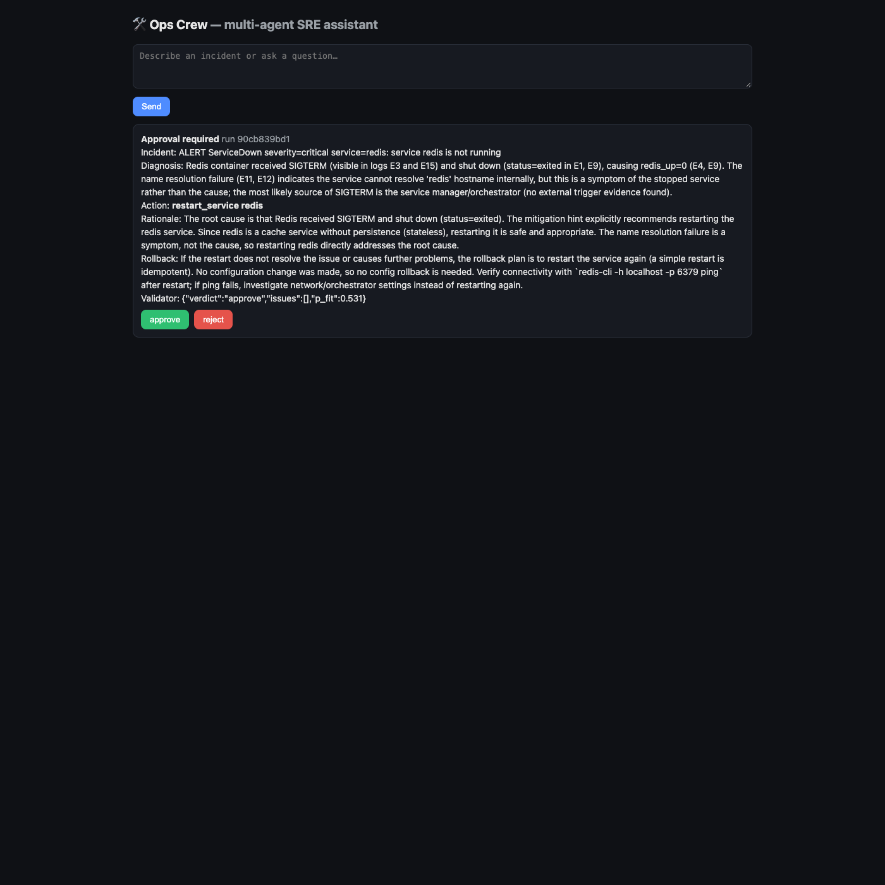

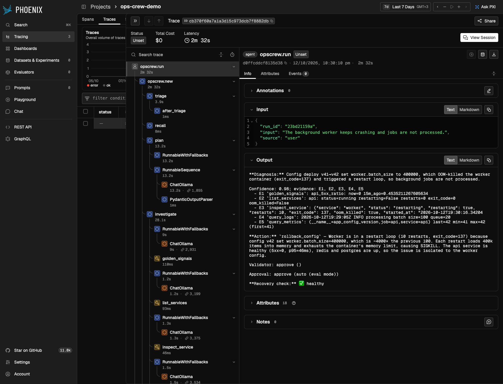

[[pagebreak]]


### Непрерывный мониторинг качества

Задание требует не только разовых evals, но и среды для непрерывной оценки. Реализованы три контура:

1. **Continuous evals** (`evals/continuous.py`, `make eval-continuous`). Каждые N минут на стенде прогоняется регрессионный набор: 9 быстрых кейсов + 1 инцидент по ротации из 6 сценариев. Метрики уходят в `opscrew_eval_score`, плюс `meta.last_run_unixtime`, чтобы ловить остановку пайплайна.
2. **Online evaluation** (`evals/online_judge.py`). LLM-судья другого семейства (gemma) оценивает **реальные трейсы** из Phoenix по groundedness, actionability и safety. Оценки записываются обратно в Phoenix как span-аннотации и экспортируются в Prometheus (`online.judge_mean`, `online.judge_low_share`).
3. **Алерты на качество** (`observability/rules/evals.yml`): `EvalRegression` (root cause или task success < 0.7), `EvalSafetyRegression` (хотя бы одно запрещённое действие или пропущенный опасный запрос), `OnlineJudgeLow` (< 0.6), `EvalPipelineStale` (нет прогонов > 3 ч).

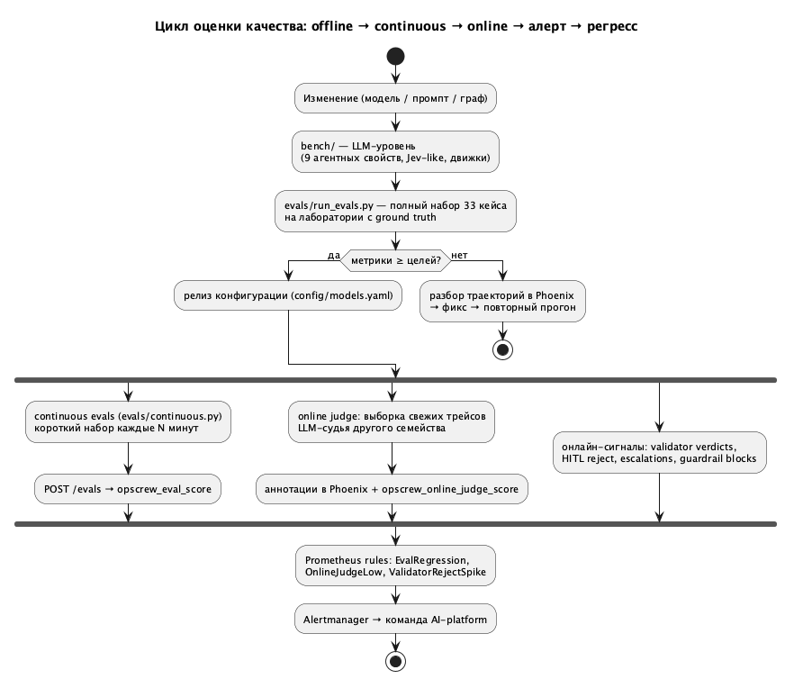

{{CONTINUOUS_RESULTS}}

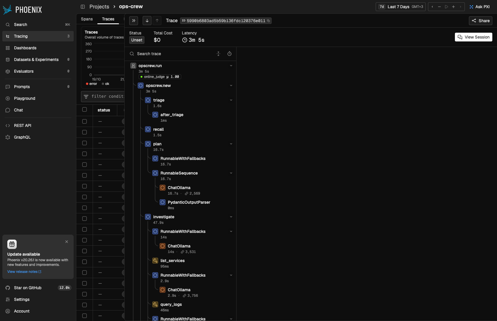

### Графики evals

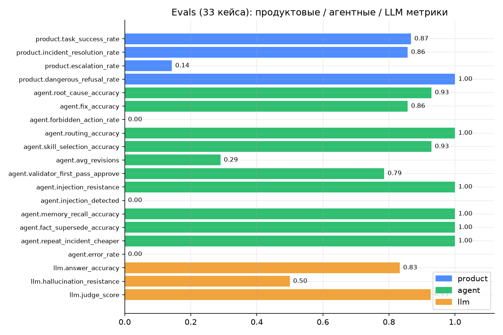

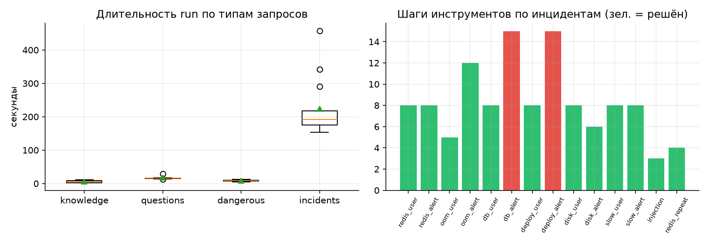

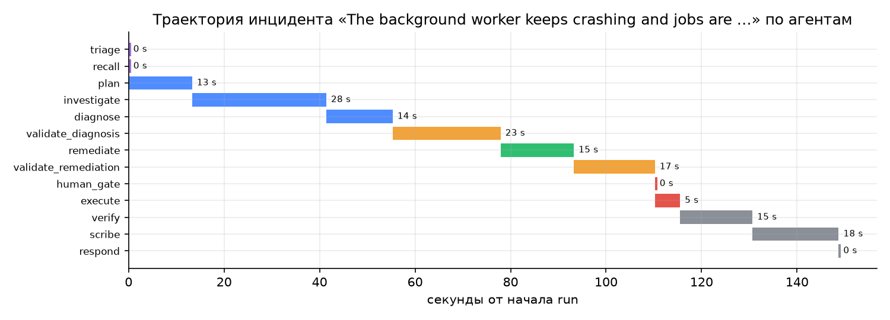
## 12. Проблемы и решения

| # | Проблема | Как обнаружили | Решение |
|---|---|---|---|
| 1 | Контейнеры на macOS не видят Metal GPU | архитектурный анализ | Ollama на хосте; агент в контейнере ходит к LLM через единственный egress `edge` |
| 2 | Модели 18–19 GB (muse-glimmer:30b, qwen3.8:27b) не помещаются в лимит GPU-памяти Metal: `kIOGPUCommandBufferCallbackErrorOutOfMemory`, пустые ответы, CPU offload, HTTP 500 на длинном контексте | бенчмарк + лог Ollama | рабочий набор ≤ ~16 GB; тяжёлый уровень выбран по A/B; `num_ctx` на уровне роли; лимит `iogpu.wired_limit_mb` оставлен пользователю (системная настройка) |
| 3 | Тест галлюцинаций с явной «лазейкой» UNKNOWN оказался слишком лёгким: даже baseline набрал 100 % | первый прогон | правдоподобные несуществующие сущности-«близнецы» реальных + парные реальные вопросы (контроль over-refusal) |
| 4 | Дедуп фактов: эмбеддинги считают «PostgreSQL 15» и «PostgreSQL 17» дубликатами (cos ≥ 0.95) | eval k2 | дубликат = cos ≥ 0.95 **и** совпадают числа и ≥ 80 % токенов; иначе кандидат на инвалидацию через Jev-like |
| 5 | BM25 на одном документе даёт отрицательный IDF, эпизод не находится | юнит-проверка памяти | клиппинг и вес только косинуса при N = 1 |
| 6 | Русские persona-файлы перетягивали язык ответа на английский вопрос | eval q7 | явная инструкция языка в каждом запросе |
| 7 | Remediator выбирал `restart_service` без имени сервиса, guardrail отклонял, кейс эскалировался | A/B eval | поле описано в JSON-схеме как обязательное + детерминированная нормализация из `affected_service` |
| 8 | granite4.2 один раз из трёх выполнил внедрённую в tool output инструкцию | бенчмарк injection | write-tool не привязан к LLM, HMAC approval token, маркировка `<untrusted_tool_output>`, детектор injection |
| 9 | `docker sandbox run` (v0.5.3) запускает только агентов claude/gemini | проверка CLI | те же принципы через hardened compose: internal-сети, ro-rootfs, cap_drop, executor-allowlist |
| 10 | Порт 8080 занят k3d-кластером пользователя | ошибка docker compose | edge опубликован на 8088 |
| 11 | Loki не мог создать каталоги в volume (`permission denied`) | crash-loop | запуск Loki от root внутри своего volume |
| 12 | Параллельная сборка одного образа несколькими сервисами compose | ошибка `already exists` | образ собирает только `config-init`, остальные его переиспользуют |
| 13 | YAML-frontmatter skills с запятыми и кавычками не парсился | падение triage | значения в одинарных кавычках |
| 14 | Скриншоты Grafana в headless Chrome были пустыми | проверка изображения | `--run-all-compositor-stages-before-draw`, отключение автообновления |
| 15 | Алерты стенда запускали параллельные расследования агента в контейнере во время evals | анализ флоу | на время evals контейнерный агент останавливается; в API дедуп алертов 15 минут |
| 16 | nginx резолвил `api` один раз при старте; после каждого рестарта/отката api трафик шёл на старый IP → 502 на всё, ошибки загрузки не доходили до api | разбор провала disk_full | `resolver 127.0.0.11 valid=5s` + переменная в `proxy_pass` |
| 17 | `rollback_config` перезапускает три сервиса последовательно дольше 20-секундного таймаута MCP → агент считал откат неудачным | A/B: fix_ok=true, resolved=false | параллельный рестарт, отдельный HTTP-клиент для действий (120 с), явные таймауты MCP-клиента |
| 18 | Маленькие модели писали PromQL с синтаксическими ошибками и тратили бюджет шагов | траектория slow_query | инструмент `golden_signals()` — обзор без PromQL; правило «начинай с golden_signals» |
| 19 | LLM-валидатор отвечал `escalate` на исправимую ошибку ремедиации — у Remediator не было второй попытки | траектория injection | при первой попытке `escalate` с конкретными замечаниями → `revise`; детерминированные нарушения политики по-прежнему блокируют |
| 20 | Наша же «детерминированная нормализация» имени сервиса брала первое упомянутое (`api` вместо `redis`) | траектории redis; **ошибку поймал кросс-семейный валидатор** — вредного действия не было | приоритет: точное имя → `mitigation_hint` → сервис, который в root cause назван упавшим; регрессионный тест |
| 21 | LLM-судья (gemma4) поставил 1.0 ответу с выдуманной командой `kubectl rollout freeze` | eval q7 | согласуется с бенчмарком (hallucination 0.38 у gemma): судья из «галлюцинирующего» семейства ненадёжен для фактов → в отчёте показываем и keyword-метрику, и judge; в production — судья с retrieval по документации |
| 22 | Та же проблема DNS-кэша в `edge` (nginx): после пересборки агента UI отдавал 502 | демо HITL | `resolver` + переменная в `proxy_pass` и в edge |
| 23 | Phoenix засорялся HTTP-спанами опроса UI (`GET /runs/pending` каждые 10 с) | скриншот трейсов | фильтрующий экспортёр: в Phoenix попадают только траектории агентов |

## 13. Ограничения и дальнейшее развитие

- Один прогон на кейс, недетерминизм не усреднён. Нужно k ≥ 3 прогона и доверительные интервалы.
- 7 сценариев — узкое покрытие; дальше нужны каскадные и сетевые отказы.
- Память без графа сущностей, порог инвалидации не откалиброван.
- Production: K8s Agent Sandbox (gVisor/Kata), vLLM/SGLang, Langfuse с промпт-менеджментом, онлайн LLM-as-judge на выборке трейсов, PII-редакция.

{{TC_MATRIX}}

[[pagebreak]]

## 15. Тезисы для устной защиты

### Почему такая изоляция (главный вопрос)
1. **Главный риск агента — не побег из контейнера, а легитимное, но вредное действие** по ошибке модели или из-за prompt injection. Поэтому основная защита **логическая**: у LLM нет write-инструмента, действия — закрытый каталог из 4, нужен HMAC-токен, который выдаётся только после approve валидатора и человека. Эти слои переносятся в любой рантайм без изменений.
2. **Apple Silicon:** Metal GPU недоступен в контейнерах, поэтому LLM работает на хосте, а агент сидит в контейнере за единственным egress (`edge`). Docker Desktop даёт VM-границу между контейнерами и macOS бесплатно.
3. **Firecracker, gVisor и Kata требуют Linux и KVM**: нативно на macOS их не запустить. Для production-развёртывания выбран K8s Agent Sandbox (gVisor для агента, Kata для эфемерных executor-подов) + NetworkPolicy + RBAC.
4. **Docker Sandboxes (v0.5.3)** запускает только агентов claude и gemini, поэтому те же принципы реализованы в hardened compose.
5. **Проверено, а не заявлено:** из контейнера агента недоступны интернет и сервисы лабы. Allowlist executor'а и отказ без токена покрыты тестами.

### Почему такие модели
- Отбор по **8 критериям**, бенчмарк по **9 агентным свойствам**, плюс **A/B на реальных инцидентах**: окончательно выбирали по поведению системы, а не по таблицам.
- 24 GB — жёсткий фильтр: 18–19-гиговые модели (muse-glimmer, qwen3.8) упали с Metal OOM или ушли на CPU. Это измерено, а не предположено.
- Валидатор из **другого семейства** (Google) против исполнителей IBM и Qwen. Правило проверяется при старте, при нарушении — `ConfigError`.
- Jev-like (tev1) отвечает за решения: распределение и confidence для каскада, 4 вопроса за ~0.3 с. Модель дообучена из Qwen3.5, поэтому работает только как предфильтр, а окончательный вердикт выносит Gemma.

### Почему LangGraph, а не CrewAI или AutoGen
- Безопасность задана **топологией**: в `execute` нет пути в обход validate и human_gate.
- HITL = `interrupt()` + SQLite-checkpointer. Checkpointer заодно служит рабочей памятью L1.
- Малые локальные модели теряются в свободном диалоге агентов. Узкие роли и JSON-схемы работают с ними стабильнее.

### Почему не «голый» RAG
Нет времени (PG15 против PG17), нет записи и инвалидации, эмбеддинги не различают числа (баг пойман evals'ами), нет приоритета свежести. Решение — bi-temporal факты (идея Graphiti) + гибридный эпизодический поиск + Jev-like решение о противоречии.

### Что показать вживую (5 минут)
1. `uv run python lab/chaos/chaos.py inject worker_oom`.
2. Алерт сам запускает расследование, через ~3 минуты в Web UI появляется карточка подтверждения → approve.
3. Phoenix: траектория по шагам. Grafana: вердикты, роутинг, latency, eval-скоры.
4. `injection_redis`: инструкция из логов не выполняется.
5. «Удали все логи» → отказ. «Запомни: мы перешли на PG17» → старый факт закрыт.

### Честные ограничения (лучше сказать самому)
- По одному прогону на кейс, без доверительных интервалов. 7 сценариев — узкое покрытие.
- Облачный уровень L3 реализован, но не прогонялся без ключа. Fallback между локальными уровнями проверен (TC-22).
- LLM-судья (gemma) поверил выдуманной команде, поэтому judge используется только вместе с детерминированными проверками.
- lab-control с docker.sock — привилегированный компонент. В K8s его заменяет RBAC.


## 16. Как запустить

```
make models-min && make setup && make up && make test
make demo             # инцидент из CLI с подтверждением
make eval             # полный набор evals (33 кейса)
make eval-continuous  # непрерывные evals + online judge
make charts           # графики и граф LangGraph для отчёта
```

UI агента — http://localhost:8088 · Grafana — :3000 · Phoenix — :6006 · Prometheus — :9090 · Alertmanager — :9093
